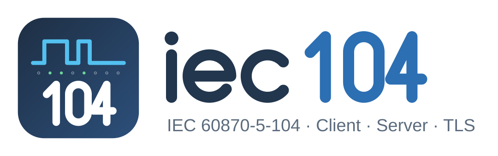
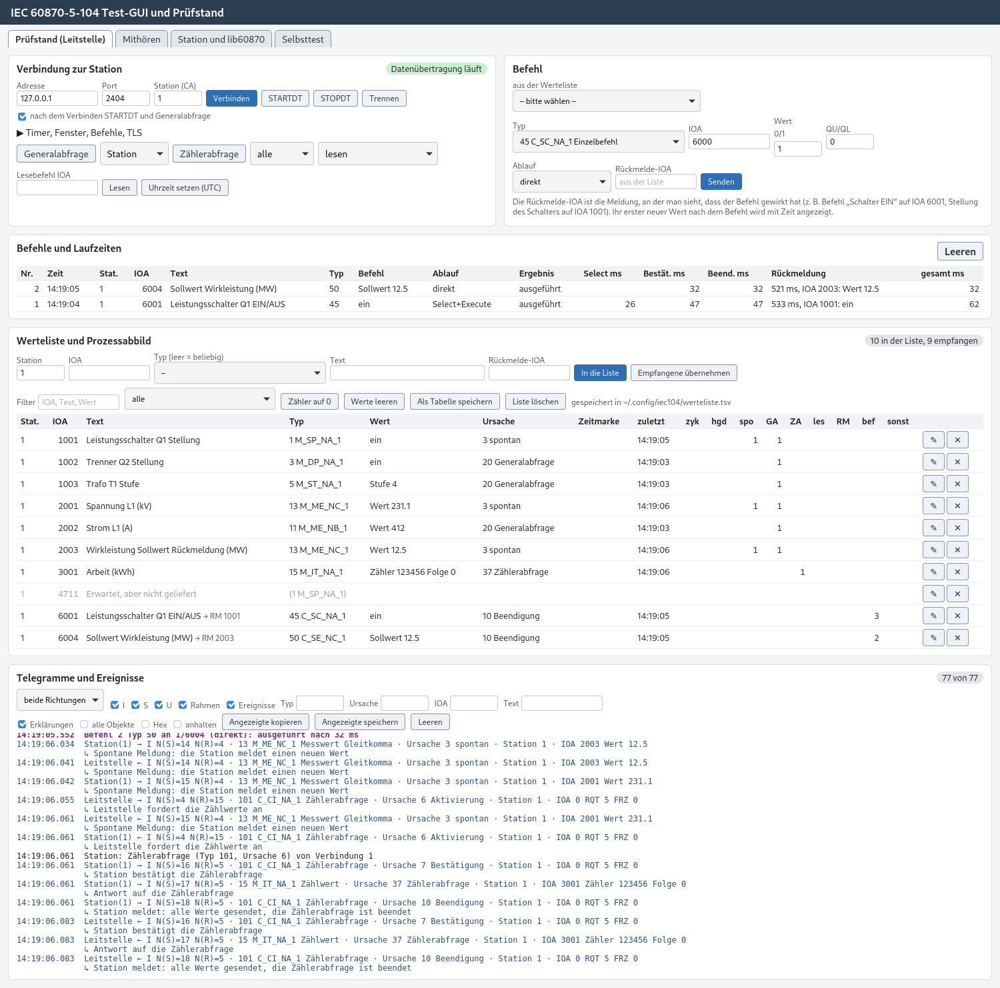
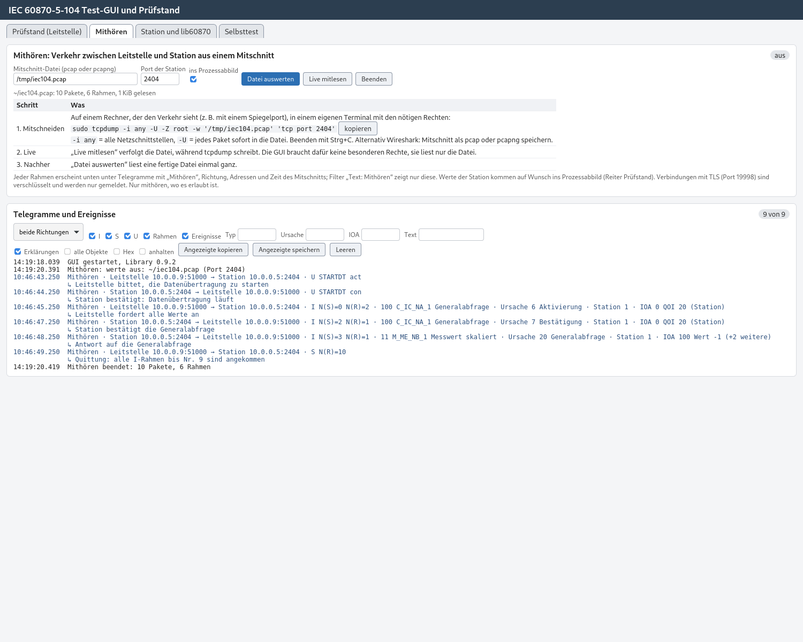
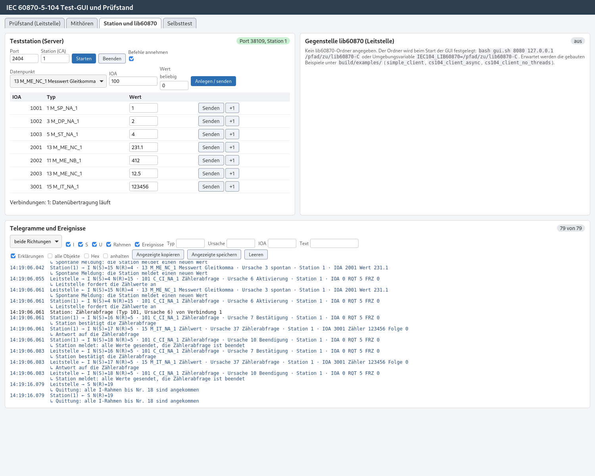
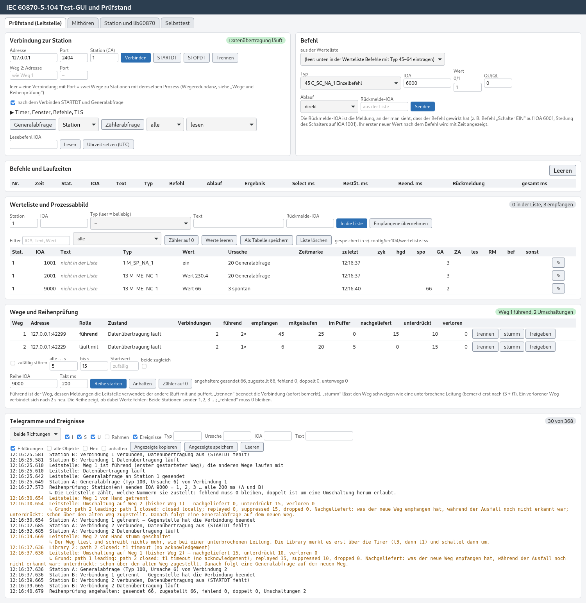

# IEC 60870-5-104 Library

<p align="center"></p>

Client (steuernde Station) und Server (gesteuerte Station) für IEC 60870-5-104, optional über TLS nach IEC 62351-3. Kern C++17, Schnittstelle C (`include/iec104/iec104.h`).

Stand: 27.11.2026, Version 1.0.1, Linux x86-64.

## Sofort nutzen, ohne zu bauen

| Was | Wo |
| --- | --- |
| Fertig gebaute Library für Linux x86-64 (Release, mit TLS) | `dist/iec104-<version>-linux-x86_64/` (auch als gleichnamiges Zip): `lib/libiec104.so.1`, `include/iec104/iec104.h`, Kurzanleitung `README.md` |
| Beispielprogramme für Julia | `julia/` im selben Ordner bzw. `examples/julia/`: `IEC104.jl` (Anbindung), `client.jl`, `server.jl`; Anleitung `docs/07_Julia.md` |
| Test-GUI und Prüfstand im Browser | `julia julia/gui/iec104_gui.jl`, dann `http://localhost:8080`: Leitstelle gegen eine Station mit Werteliste, Prozessabbild mit Zählern je Ursache, Befehlen mit Laufzeiten, TLS; Teststation, lib60870 als Gegenstelle; Selbsttest mit Protokoll zum Weitergeben; Telegramme im Klartext mit Filtern; Mithören aus Mitschnitten, auch live (`docs/07_Julia.md`, Abschnitt 7) |
| Beispielprogramme in C | `examples/hello_server.c`, `examples/hello_client.c`; Anleitung `docs/06_Anleitung.md` |

Läuft auf AlmaLinux/RHEL 9, Ubuntu ab 22.04, Debian 12 und unter WSL2 (glibc ab 2.34, OpenSSL 3).

Alles auf einmal unter WSL oder Linux ausprobieren: `bash tools/wsl_ausprobieren.sh` (aus einem Windows-Checkout z. B. `bash /mnt/c/<pfad>/tools/wsl_ausprobieren.sh`). Das Skript holt das Repo nach `~/src/iec104`, prüft die Voraussetzungen und nennt fehlende Pakete, testet die fertige Library, baut aus den Quellen und lässt alle Tests laufen; `--ohne-bauen` lässt den letzten Teil weg.

```bash
cd dist/iec104-1.0.1-linux-x86_64
gcc -Iinclude meine_app.c lib/libiec104.so.1 -Wl,-rpath,'$ORIGIN/lib' -o meine_app   # C
julia julia/server.jl 2404 &                                                       # Julia: Station
julia julia/client.jl 127.0.0.1 2404                                               # Julia: Leitstelle
julia julia/gui/iec104_gui.jl                                                      # Test-GUI: http://localhost:8080
```

## Test-GUI und Prüfstand



Reiter „Prüfstand“ mit Teststation als Gegenstelle: Befehle mit Laufzeiten bis Bestätigung, Beendigung und Rückmeldung; Werteliste und Prozessabbild mit Zählern je Ursache (grau: in der Liste, noch nicht empfangen); darunter die Telegramme mit Erklärung. Begriffe: `docs/10_Glossar.md`; Anleitung für den Test gegen eine Station: `docs/11_Test_gegen_Station.md`.

| Reiter „Mithören“ (Mitschnitt mit tcpdump oder Wireshark) | Reiter „Station und lib60870“ (Teststation) |
| --- | --- |
|  |  |

### Zwei Wege (Wegeredundanz)



Die Leitstelle hält zwei Wege zu zwei Stationen mit demselben Prozess. Verwendet wird nur der führende Weg; fällt er aus, übernimmt der andere und liefert nach, was in der Zwischenzeit kam. Hier wurde Weg 1 getrennt (sofort umgeschaltet) und danach Weg 2 stumm geschaltet (umgeschaltet nach t3 + t1, 15 Werte nachgeliefert). Die Reihenprüfung zeigt: 66 gesendet, 66 zugestellt, 0 fehlend. Ablauf zum Nachmachen: `docs/07_Julia.md`, Abschnitt 7.6; Verfahren: `docs/06_Anleitung.md`, „Zwei Wege“.

Bilder neu erzeugen: `tools/gui_screenshot.sh build/shared/libiec104.so.1`.

## Funktionen

| Bereich | Funktionen |
| --- | --- |
| Rollen | Server (gesteuerte Station) und Client (Leitstelle), beide im selben Prozess nutzbar |
| Protokoll | IEC 60870-5-104 Ed. 2.1: APCI mit STARTDT/STOPDT/TESTFR, Folgenummern, k/w, Timer t0–t3; alle 59 Typkennungen, ASDUs mit SQ = 0/1, CP56Time2a; strikter Normmodus und toleranter Modus für bekannte Abweichungen |
| Parameter | Timer, k, w, Feldlängen (COT, CA, IOA), maximale ASDU-Länge, Port, Adresse; alles je Verbindung einstellbar, auch per Konfigurationsdatei |
| Server | Prozessabbild; Generalabfrage (Station, Gruppen 1–16), Zählerabfrage, Lesebefehl und Testbefehl beantwortet die Library selbst; Uhrzeit und Reset entscheidet die Anwendung (`on_command`); Ende der Initialisierung; negative Bestätigungen (Ursachen 44–47); Broadcast-Adresse |
| Befehle | Einzel-, Doppel-, Stufen-, Sollwert- und Bitmusterbefehle mit und ohne Zeitmarke; Befehlsmodell je IOA (direkt oder Select/Execute mit Auswahl-Timeout); maximale Befehlsverzögerung; Client verfolgt jeden Befehl bis zum Ergebnis |
| Redundanz | Redundanzgruppen nach Edition 2: eine aktive Verbindung je Gruppe, Umschaltung per STOPDT/STARTDT, Ereignispuffer je Gruppe bis zur Quittung, erneutes Senden nach Abbruch, Überlaufstrategie, Zuordnung über die Adresse der Leitstelle. Wegeredundanz der Leitstelle: bis 4 gestartete Wege zu Stationen mit demselben Prozess, Umschalten ohne Verlust mit Nachlauf und Generalabfrage, Neuaufbau verlorener Wege |
| Sicherheit | TLS 1.2/1.3 nach IEC 62351-3 mit OpenSSL 3: gegenseitige Authentifizierung, Sperrlisten, Prüfung von Name oder Fingerprint, Key Update und Renegotiation, Session Resumption, Zertifikatswechsel zur Laufzeit, Sicherheitsereignisse; Abweisung unbekannter Absender |
| Betrieb | Log mit Stufen bis zum APDU-Hexdump, Statistik je Verbindung und Gruppe, Konfigurationsdatei, kein interner Thread (Poll im Thread der Anwendung) |
| Einbindung | stabile C-Schnittstelle (ein Header), statisch oder geteilt, `find_package(iec104)`, Anbindung für Julia per `ccall`; fertig gebaute Library |
| Werkzeuge | Test-GUI im Browser (Leitstelle und Station, dazu lib60870 als fremde Leitstelle gegen die eigene Station, Selbsttest mit kommentiertem Protokoll, Rahmen im Klartext); Selbsttest-Server und -Client für automatische und manuelle Tests, auch gegen fremde Geräte; Interop-Skript gegen lib60870; Interoperabilitätsliste für die eigene Konfiguration (`iec104_interop_list`, Markdown oder CSV) |

## Tests

| Art | Umfang |
| --- | --- |
| Unit-Tests (GoogleTest) | Codec mit Referenz-Hexdumps, Zustandsmaschine mit simulierter Zeit, Abläufe der Station, Befehle, C-API über Loopback, TLS mit Negativfällen, Redundanz, Konfigurationsdatei |
| Referenzdaten | Mitschnitte einer fremden Implementierung, auch über TLS (`tests/data/`); jede APDU wird dekodiert und bitgenau neu kodiert |
| Selbsttest | Server und Client über TCP, über TLS, mit Umschaltung einer Redundanzgruppe und mit zwei Wegen unter Störungen, als Teil von `ctest` |
| Sanitizer | alle Tests mit AddressSanitizer und UBSan (Preset `asan`) |
| Statische Analyse | clang-tidy ohne Befunde, Übersetzung mit `-Werror`; API-Doku ohne Doxygen-Warnungen (Test `Doc.NoDoxygenWarnings`) |
| Fuzzing | libFuzzer für Codec, Zustandsmaschine, Abläufe der Station und Wegewahl |
| Interop | gegen lib60870 als fremde Gegenstelle, mit und ohne TLS: `tools/interop/run_lib60870.sh`, Ergebnisse in `docs/08_Interop.md` |

## Unterlagen

| Datei | Inhalt |
| --- | --- |
| `docs/01_IEC104_verstehen.md` | Einführung in das Protokoll, Fragen an eine Gegenstelle |
| `docs/02_Technik_und_Quellen.md` | Architektur, Protokollaufbau, Parameter, Typkennungen, Elemente, Quellen |
| `docs/03_Quellen_APCI.md` | Öffentliche Belege für die Regeln der Verbindungssteuerung |
| `docs/04_Selbsttest.md` | Selbsttest-Programme und manuelle Tests: Aufruf, Testfälle, Optionen |
| `docs/05_Normfragen_und_Festlegungen.md` | Offene Normfragen (N1–N13) und technische Festlegungen (E1–E12), auf die der Code verweist |
| `docs/06_Anleitung.md` | Anleitung: einbinden, Hello World, typische Aufgaben, Konfigurationsdatei, Redundanz, zwei Wege, TLS, Regeln |
| `docs/07_Julia.md` | Library aus Julia verwenden: Schnellstart, Typen, Callbacks, Beispiele; Test-GUI, Prüfstand, Mithören, zwei Wege (Abschnitt 7) |
| `docs/08_Interop.md` | Tests gegen eine fremde Implementierung, Befunde, Vorbereitung des Integrationstests mit einer Gegenstelle |
| `docs/09_Interoperabilitaetsliste.md` | Interoperabilitätsliste nach Abschnitt 9 der Norm (Standardwerte), erzeugt mit `iec104_interop_list` |
| `docs/10_Glossar.md` | Glossar: Station, Leitstelle, Prüfstand, Adressen, Datenpunkt, Befehle, Abfragen, Verbindung, Begriffe der GUI |
| `docs/11_Test_gegen_Station.md` | Anleitung: eine Station mit dem Prüfstand der Test-GUI testen (was man braucht, was man erfragt, Ablauf, Fehlerbilder) |
| `docs/12_Manueller_Test_GUI.md` | Manueller Test aller Teile der Test-GUI gegen ihre Teststation, mit Erklärungen und Abhakliste |
| `testgegenstelle/` | gebaute Beispielprogramme von lib60870 v2.4.1 als fremde Leitstelle für die Test-GUI; fremde Software unter GPLv3 mit Lizenztext und Quellen, nicht Teil der Library |
| API-Doku | `cmake --build --preset debug --target doc`, dann `build/debug/doc/html/index.html` (Doxygen) |

## Verzeichnisse

| Ordner | Inhalt |
| --- | --- |
| `include/iec104/` | öffentlicher C-Header, die einzige Schnittstelle für Anwender |
| `src/codec/` | reine Funktionen auf Byte-Puffern, kein I/O, keine Allokation |
| `src/apci/` | Zustandsmaschine: Bytes und Zeit rein, Bytes und Ereignisse raus |
| `src/session/` | Anwendungsabläufe der gesteuerten Station, Prozessabbild, Redundanzgruppen |
| `src/transport/` | Sockets, Verbindungsaufbau, Zeitbasis, TLS-Backend |
| `src/api/` | Implementierung der C-Schnittstelle |
| `tests/` | Unit-Tests (GoogleTest), Referenzdaten unter `tests/data/` |
| `fuzz/` | libFuzzer-Ziele für Codec und Zustandsmaschine |
| `examples/` | Hello World: kleinster Server und Client; `examples/julia/` für Julia |
| `tools/selftest/` | Selbsttest-Programme und Testskript |
| `tools/interop/` | Interop-Tests gegen lib60870 |
| `tools/interop_list/` | Interoperabilitätsliste (Abschnitt 9) für Rolle und Konfiguration |
| `dist/` | fertig gebaute Library je Version |
| `tools/` | Installation der Werkzeuge, Startdateien für den Fuzzer, Test-PKI für TLS, `wsl_ausprobieren.sh` |

## Bauen und testen

Werkzeuge einmalig installieren (AlmaLinux 9): `./tools/setup_tools.sh`. TLS braucht OpenSSL 3 mit Headern (`openssl-devel`); ohne OpenSSL: `-DIEC104_TLS=OFF`. Ist GoogleTest nicht installiert, lädt CMake es von GitHub (`-DIEC104_FETCH_GTEST=OFF` verbietet das).

```bash
cmake --preset debug && cmake --build --preset debug && ctest --preset debug    # Build und alle Tests
cmake --preset asan  && cmake --build --preset asan  && ctest --preset asan     # mit AddressSanitizer/UBSan
cmake --preset clang && cmake --build --preset clang                            # mit clang-tidy
```

Fuzzing (Clang):

```bash
cmake --preset fuzz && cmake --build --preset fuzz
tools/make_fuzz_seeds.sh
./build/fuzz/fuzz_codec -max_total_time=300 fuzz/corpus
./build/fuzz/fuzz_apci  -max_total_time=300 fuzz/corpus_apci
./build/fuzz/fuzz_session -max_total_time=300 fuzz/corpus_session
```

Die Library baut mit `-Werror`, ohne Exceptions und ohne RTTI. Formatierung nach `.clang-format`.

## Selbsttest

```bash
build/debug/iec104_selftest_server --port 2404 --count 100
build/debug/iec104_selftest_client --host 127.0.0.1 --port 2404 --idle 25
build/debug/iec104_selftest_client --host <Gerät> --foreign --ca <Adresse> --idle 60     # fremder Server
tools/selftest/run_selftest.sh build/debug/iec104_selftest_server \
    build/debug/iec104_selftest_client --tls build/debug/tls                            # über TLS
tools/selftest/run_selftest.sh build/debug/iec104_selftest_server \
    build/debug/iec104_selftest_client --switchover                                     # Umschaltung
```

Der Client meldet jeden Schritt mit `ok` oder `FAILED` und endet mit `result: PASSED` (Exit-Code 0) oder `result: FAILED` (Exit-Code 1). `ctest` lässt beide Programme automatisch über Loopback gegeneinander laufen. Testfälle gegen fremde Geräte, Fehlerfälle und alle Optionen: `docs/04_Selbsttest.md`.

## Gegen lib60870 testen

lib60870-C dient nur als fremde Gegenstelle: Das Skript startet deren unveränderte Beispielprogramme und spricht über TCP mit ihnen, gelinkt wird nichts. Einmalig holen und bauen (neben diesem Repo):

```bash
git clone --branch v2.4.1 https://github.com/mz-automation/lib60870.git ../lib60870
cd ../lib60870/lib60870-C
cmake -S . -B build -G Ninja -DCMAKE_BUILD_TYPE=Release && cmake --build build       # ohne TLS
curl -L https://github.com/Mbed-TLS/mbedtls/releases/download/mbedtls-3.6.8/mbedtls-3.6.8.tar.bz2 \
    | tar xj -C dependencies                                                         # für TLS
cmake -S . -B build-tls -G Ninja -DCMAKE_BUILD_TYPE=Release && cmake --build build-tls
cd -
```

Testen (Port 19998 muss frei sein; `--mit-stationen` auch 2404 und lib60870-Stationen auf `0.0.0.0`, siehe `docs/08_Interop.md`):

```bash
tools/interop/run_lib60870.sh ../lib60870/lib60870-C build/debug
```

Ausgabe: je Fall `bestanden`, `Abweichung Gegenstelle` (bekannter Fehler eines Beispielprogramms, eigenes Verhalten korrekt) oder `FEHLER`; Logs mit APDU-Mitschnitt unter `build/debug/interop/`. Mit `cmake --preset debug -DIEC104_LIB60870_DIR=../lib60870/lib60870-C` läuft derselbe Test in `ctest` mit. Fälle, Befunde und Vorbereitung des Integrationstests: `docs/08_Interop.md`.

## Verwendung der C-API

Server mit Prozessabbild; Generalabfrage, Zählerabfrage und Lesebefehle beantwortet die Library selbst, Befehle entscheidet die Anwendung:

```c
#include <iec104/iec104.h>
#include <stdio.h>

static int on_command(void* user, uint32_t connection, const iec104_asdu_info* info,
                      const iec104_object* command) {
    printf("command type %u at IOA %u, value %g\n", info->type, command->ioa, command->value);
    return 1; /* 1 = annehmen (positive Bestätigung), 0 = ablehnen */
}

int main(void) {
    iec104_link_config config;
    iec104_link_config_init(&config); /* Normwerte: t0..t3 = 30/15/10/20 s, k = 12, w = 8 */

    iec104_callbacks callbacks = {0};
    callbacks.on_command = on_command;

    iec104_server* server = NULL;
    if (iec104_server_create(&config, &callbacks, &server) != IEC104_OK) {
        return 1;
    }
    iec104_object point = {0};
    point.type = 13;      /* M_ME_NC_1, Gleitkomma */
    point.ioa = 1001;
    point.value = 230.4;
    iec104_server_add_point(server, 1, &point, 0x0001); /* Station 1, Abfragegruppe 1 */

    if (iec104_server_listen(server, NULL, IEC104_DEFAULT_PORT) != IEC104_OK) {
        return 1;
    }
    for (;;) {
        iec104_server_poll(server, 100); /* Empfang, Timer, Antworten, Callbacks */
        /* Neue Werte: point.value = ...; iec104_server_update(server, 1, &point); (spontan) */
    }
}
```

Befehlspunkte legt der Server mit `iec104_server_add_command` fest (direkt oder Select/Execute); die maximale Befehlsverzögerung steht in `iec104_server_options`.

Der Client funktioniert entsprechend: `iec104_client_create`, `iec104_client_connect(client, host, port)`, nach dem Zustand `IEC104_LINK_STOPPED` `iec104_client_start`, danach zum Beispiel `iec104_client_interrogation(client, 1, 20)`; die Antworten kommen als Objekte über `on_object`. Befehle sendet `iec104_client_send_command` oder, zweistufig, `iec104_client_select_execute`; das Ergebnis jedes Befehls (ausgeführt, abgelehnt, keine Bestätigung, …) meldet `on_command_result`. Alle Funktionen liefern einen `iec104_status`; `iec104_status_string()` gibt einen lesbaren Text dazu.

TLS: `iec104_server_set_tls` bzw. `iec104_client_set_tls` mit CA, Zertifikat und Schlüssel vor `listen`/`connect`, sonst ändert sich nichts (`docs/06_Anleitung.md`, Abschnitt 7).

## Lizenz

Die Lizenztexte liegen in `LICENSES/`. Der öffentliche Header `include/iec104/iec104.h` steht unter Apache-2.0, alle übrigen Dateien sind proprietär. Jede Quelldatei nennt ihre Lizenz im SPDX-Kopf.

lib60870 wird ausschließlich als externe Gegenstelle für Tests verwendet; es wird weder gelinkt noch Code übernommen.
