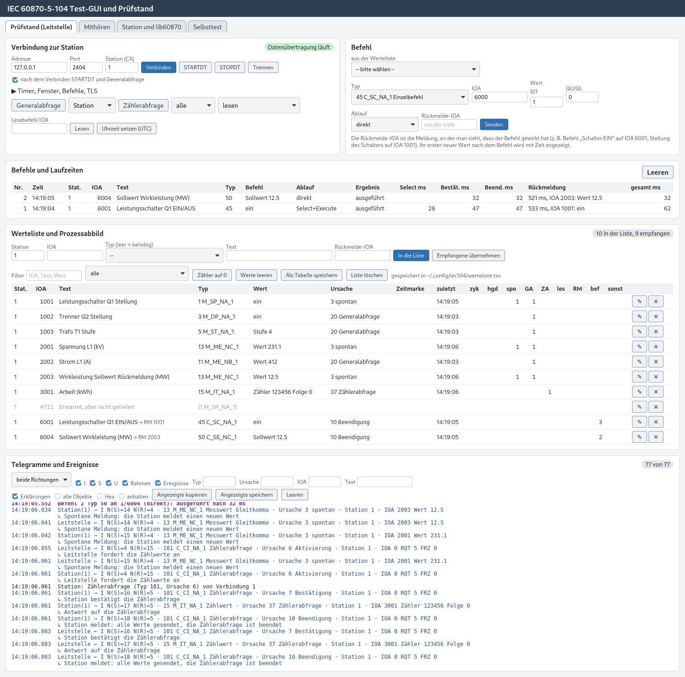
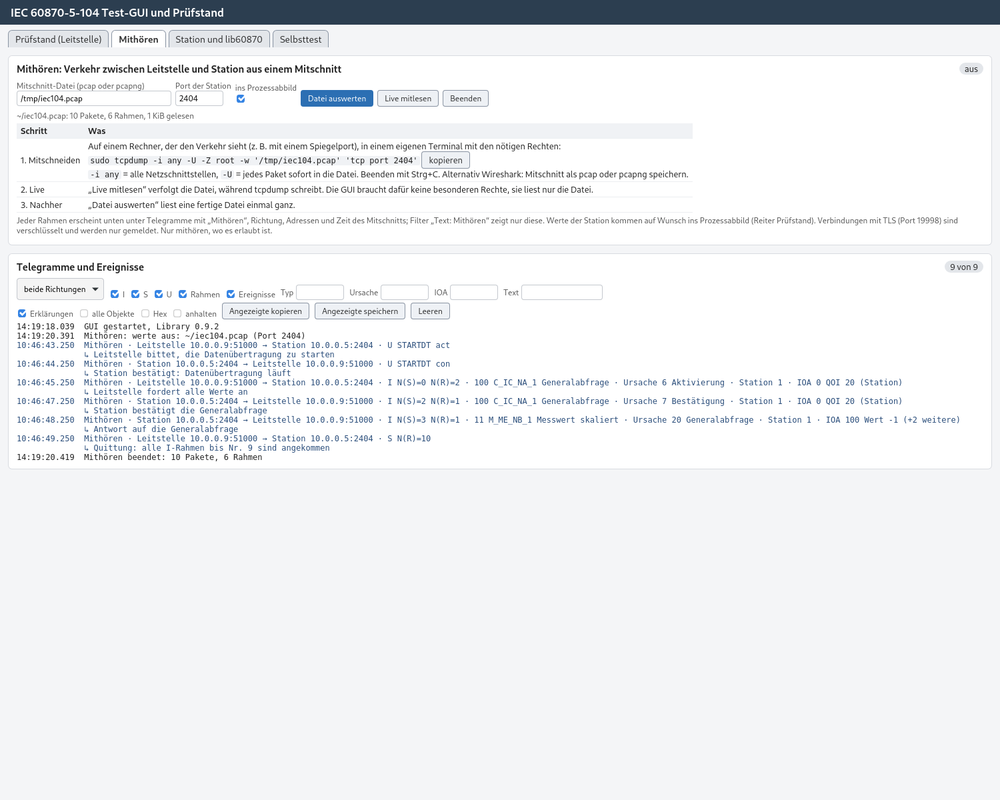

# Anleitung: Library aus Julia verwenden

Stand: 26.11.2026 · geprüft mit Julia 1.13 · Dateien: `examples/julia/` (im Binärpaket `julia/`)

Julia ruft die C-Schnittstelle direkt mit `ccall` auf. Es gibt kein Paket zu installieren und nichts zu übersetzen: Die fertig gebaute Library und die Datei `IEC104.jl` genügen.

## 1. Schnellstart

Binärpaket `iec104-<version>-linux-x86_64.zip` entpacken, dann:

```bash
cd iec104-0.9.3-linux-x86_64
julia julia/server.jl 2404 &             # Station 1, Messwert IOA 100, steigt jede Sekunde
julia julia/client.jl 127.0.0.1 2404     # Generalabfrage, danach drei spontane Werte
```

Ausgabe des Clients:

```
type 70  cause 4  station 1  IOA 0  value 0.0       Ende der Initialisierung
type 100  cause 7  station 1  IOA 0  value 0.0      Generalabfrage bestätigt
type 13  cause 20  station 1  IOA 100  value 30.0   Wert aus der Abfrage
type 100  cause 10  station 1  IOA 0  value 0.0     Generalabfrage beendet
type 13  cause 3  station 1  IOA 100  value 31.0    spontan
```

| Datei | Inhalt |
| --- | --- |
| `IEC104.jl` | Modul `IEC104`: Typen wie im Header, Funktionen für Server und Client (u. a. `client_interrogation`, `client_read`, `client_send_command`, `client_clock_sync`) |
| `client.jl` | Leitstelle: verbinden, STARTDT, Generalabfrage, Werte ausgeben |
| `server.jl` | Station: ein Messwert, spontane Meldung jede Sekunde, Befehle annehmen; lauscht auf `127.0.0.1` (dritter Parameter: andere Adresse) |

`IEC104.jl` sucht die Library in dieser Reihenfolge:

| Ort | Wann |
| --- | --- |
| Umgebungsvariable `IEC104_LIB` | z. B. `IEC104_LIB=/opt/iec104/lib/libiec104.so.0 julia app.jl` |
| `../lib/libiec104.so.0` neben `IEC104.jl` | Aufbau des Binärpakets |
| Suchpfad des Systems | `LD_LIBRARY_PATH` oder installiert |

## 2. Eigenes Programm

```julia
include("julia/IEC104.jl")
using .IEC104

println(IEC104.version(), ", TLS: ", IEC104.tls_available())

config = LinkConfig()        # Normwerte (iec104_link_config_init)
config.t1_ms = 250_000       # Felder lassen sich ändern, z. B. lange Timer einer Gegenstelle
```

## 3. Typen

Die Julia-Typen in `IEC104.jl` haben dieselben Felder in derselben Reihenfolge wie die C-Strukturen; `IEC104.jl` prüft die Größen beim Laden.

| C | Julia | Hinweis |
| --- | --- | --- |
| `uint8_t`, `uint16_t`, `uint32_t`, `int64_t` | `UInt8`, `UInt16`, `UInt32`, `Int64` | |
| `int`, Enums (`iec104_status`, `iec104_link_state`, …) | `Cint` | Werte als Konstanten, z. B. `IEC104.LINK_STARTED` |
| `double` | `Float64` | |
| `const char*` | `Cstring` | Julia-Strings werden automatisch übergeben |
| `iec104_server*`, `iec104_client*` | `Ptr{Cvoid}` | Handle; mit `*_destroy` freigeben |
| `iec104_link_config` | `mutable struct LinkConfig` | änderbar, als `Ref{LinkConfig}` übergeben |
| `iec104_object`, `iec104_asdu_info`, `iec104_time` | `struct Object`, `AsduInfo`, `IecTime` | `Object(13, 100, 1.5)` = Typ, IOA, Wert |
| `iec104_callbacks` | `mutable struct Callbacks` | Funktionszeiger aus `@cfunction` |
| `char feld[N]` | `NTuple{N,UInt8}` | für Strukturen, die `IEC104.jl` nicht enthält |

Jede Funktion des Headers lässt sich nach demselben Muster aufrufen, auch wenn `IEC104.jl` sie nicht kennt:

```julia
# iec104_status iec104_client_clock_sync(iec104_client*, uint16_t, const iec104_time*);
t = Ref{IecTime}()
ccall((:iec104_time_from_unix_ms, IEC104.LIB), Cint, (Int64, Ref{IecTime}),
      round(Int64, time() * 1000), t)
IEC104.check(ccall((:iec104_client_clock_sync, IEC104.LIB), Cint,
                   (Ptr{Cvoid}, UInt16, Ref{IecTime}), client, 1, t))
```

`IEC104.check(status)` wirft bei einem Fehler `Iec104Error` mit dem Text aus `iec104_status_string`.

## 4. Callbacks

Die Library ruft Julia-Funktionen auf, während `client_poll` bzw. `server_poll` läuft. Drei Regeln:

| Regel | Grund |
| --- | --- |
| Callbacks nur Daten speichern lassen, ausgeben und verarbeiten nach dem Poll | `println`, `sleep`, Kanäle oder `@async` können in Julia einen Taskwechsel auslösen; innerhalb eines Aufrufs aus C führt das zum Absturz („GC error“) |
| Das Objekt hinter `user` mit `GC.@preserve` am Leben halten | C kennt nur den Zeiger, der GC sieht ihn nicht |
| Signatur in `@cfunction` exakt wie im Header | falsche Typen fallen nicht auf, sondern lesen falsche Daten |

Muster aus `client.jl`:

```julia
mutable struct ClientState
    state::Cint
    received::Vector{Tuple{AsduInfo,Object}}
end

function on_object(user::Ptr{Cvoid}, ::UInt32, info::Ptr{AsduInfo}, obj::Ptr{Object})::Cvoid
    s = unsafe_pointer_to_objref(user)::ClientState
    push!(s.received, (unsafe_load(info), unsafe_load(obj)))   # nur speichern
    return nothing
end

st = ClientState(0, [])
cb = Callbacks(st; on_object = @cfunction(on_object, Cvoid,
                   (Ptr{Cvoid}, UInt32, Ptr{AsduInfo}, Ptr{Object})))
GC.@preserve st begin
    client = client_create(LinkConfig(), cb)
    client_connect(client, "127.0.0.1", 2404)
    while true
        client_poll(client, 100)
        for (i, o) in st.received                # hier ausgeben, rechnen, speichern
            println("IOA $(o.ioa) = $(o.value)")
        end
        empty!(st.received)
        # ... STARTDT, Abfragen, Abbruchbedingung wie in client.jl
    end
end
```

| Callback | Signatur für `@cfunction` | Rückgabe |
| --- | --- | --- |
| `on_state` | `(Ptr{Cvoid}, UInt32, Cint, Cint)` | `Cvoid` |
| `on_object` | `(Ptr{Cvoid}, UInt32, Ptr{AsduInfo}, Ptr{Object})` | `Cvoid` |
| `on_command` (Server) | `(Ptr{Cvoid}, UInt32, Ptr{AsduInfo}, Ptr{Object})` | `Cint`: 1 annehmen, 0 ablehnen |
| `on_command_result` (Client) | `(Ptr{Cvoid}, UInt16, Ptr{Object}, Cint)` | `Cvoid` |
| `on_asdu` | `(Ptr{Cvoid}, UInt32, Ptr{UInt8}, Csize_t)` | `Cvoid` |
| `on_security` | `(Ptr{Cvoid}, UInt32, Cint, Cstring)` | `Cvoid` |

`on_command` muss sofort entscheiden. Die Entscheidung selbst (z. B. Wertebereich prüfen) ist erlaubt, nur keine Ausgabe und kein Warten.

## 5. Server

Kern von `server.jl`:

```julia
server = server_create(LinkConfig(), cb)
server_add_point(server, 1, Object(13, 100, 0.0))   # Station 1, M_ME_NC_1, Abfragegruppe 1
server_listen(server, 2404)
value = 0.0
while true
    server_poll(server, 100)                         # Abfragen beantwortet die Library selbst
    value += 1
    server_update(server, 1, Object(13, 100, value)) # Wert ändern und spontan senden
end
```

## 6. Regeln

| Regel | Grund |
| --- | --- |
| Ein Handle nur in einem Task benutzen; Poll, Senden und Auswerten in derselben Schleife | die Library hat keine Sperren (docs/05, E8) |
| `try … finally *_destroy(handle) end` | schließt Verbindungen auch nach Strg-C oder Fehler |
| `IEC104.jl` und Library aus derselben Version verwenden | Strukturen können sich zwischen Versionen ändern; `IEC104.jl` prüft die Größen beim Laden |
| Typen, Ursachen und Qualitätsbits: Tabellen in `include/iec104/iec104.h` | Kommentar zu `iec104_object` |

## 7. Test-GUI im Browser

`gui/iec104_gui.jl` ist Test-GUI und Prüfstand mit Oberfläche im Browser. Es braucht nur Julia, keine Pakete.

| Reiter | Inhalt |
| --- | --- |
| Prüfstand (Leitstelle) | Leitstelle gegen eine Station, z. B. ein Gerät im Netz: Werteliste, Prozessabbild mit Zählern je Ursache, Befehle mit Laufzeiten (Abschnitt 7.4) |
| Mithören | Verkehr zwischen fremder Leitstelle und Station aus einem Mitschnitt (tcpdump, Wireshark), auch live (Abschnitt 7.5) |
| Station und lib60870 | eigene Teststation und lib60870 als fremde Leitstelle (Abschnitt 7.1) |
| Selbsttest | prüft die Library mit eigener Station und Leitstelle (Abschnitt 7.2) |
| immer darunter | Telegramme und Ereignisse mit Filtern (Abschnitt 7.3) |

```bash
julia julia/gui/iec104_gui.jl [port] [adresse] [lib60870]   # im Binärpaket; im Quellbaum examples/julia/gui/
```

| Parameter | Default | Bedeutung |
| --- | --- | --- |
| `port` | 8080 | Port der GUI; 0 = freier Port, steht in der Startzeile |
| `adresse` | `127.0.0.1` | GUI und ihre Station lauschen nur hier |
| `lib60870` | Umgebungsvariable `IEC104_LIB60870` | Ordner `lib60870-C` (oder `lib60870` darüber) mit gebauten Beispielen, Abschnitt 7.1 |

Dann im Browser `http://localhost:8080` öffnen. Kommt unter WSL der Windows-Browser nicht an `localhost` heran: `bash gui.sh 8080 0.0.0.0` (Binärpaket) und die angezeigte Adresse der WSL öffnen.

| Bereich | Funktionen |
| --- | --- |
| Leitstelle | Verbinden (Adresse, Port, Station, Timer, k, w, tolerant, TLS mit CA, Zertifikat, Schlüssel, Name; Zeitlimits der Befehle, mit oder ohne ACTTERM), auf Wunsch gleich STARTDT und Generalabfrage; STARTDT, STOPDT, Trennen; Generalabfrage (Station, Gruppe 1–16), Zählerabfrage (Gruppe, Einfrieren, Rücksetzen), Lesebefehl, Uhrzeit |
| Befehle | Typen 45–50 und 58–63 mit QU/QL: direkt, Select dann Execute, nur Select, nur Execute; Tabelle mit Ergebnis und Laufzeiten |
| Station | Starten auf Port/Station, Datenpunkte anlegen (Typen 1, 3, 5, 9, 11, 13, 15), Wert ändern und spontan senden (+1 für schnelle Tests), Befehle annehmen oder ablehnen, Verbindungen |
| Gegenstelle lib60870 | ein Leitstellen-Beispiel von lib60870 gegen die eigene Station starten und beenden (Abschnitt 7.1) |
| Selbsttest | prüft die Library mit eigener Station und Leitstelle (Abschnitt 7.2) |
| Telegramme und Ereignisse | Zustände, Abfragen und Befehle an die Station, Befehlsergebnisse, TLS-Ereignisse, Fehler (rot) und Warnungen (braun) der Library, Ausgabe von lib60870; jeder gesendete und empfangene Rahmen dekodiert und erklärt (Abschnitt 7.3) |

Beide Seiten lassen sich gegeneinander testen: Station auf Port 2404 starten, Punkt anlegen, Leitstelle auf `127.0.0.1:2404` verbinden, STARTDT, Generalabfrage.

| Hinweis | Grund |
| --- | --- |
| GUI und Station lauschen nur auf `127.0.0.1` | die GUI hat keine Anmeldung, kann Befehle senden und Programme starten; eine andere Adresse nur bewusst als zweiter Parameter |
| Anfragen nur mit Host `localhost` oder IP-Adresse samt Port der GUI, `/api/` nur mit Kopfzeile `X-IEC104-GUI: 1`, nur GET, kein CORS, nicht einbettbar | eine fremde Webseite im selben Browser kann die GUI nicht steuern, auch nicht über DNS-Rebinding |
| Die GUI ist ein Testwerkzeug | eine Verbindung je Seite; gespeichert wird nur die Werteliste |
| Eigene Erweiterungen | `iec104_gui.jl` (Julia, Aktionen in `ACTIONS`), `selftest.jl` (Selbsttest), `frames.jl` (Rahmen in Worten), `capture.jl` (Mitschnitte lesen), `index.html` (Seite) |
| Test | `tests/gui/test_gui.sh` mit Selbsttest und Mithören; in `ctest` (Preset `shared`) als `Julia.Gui`, mit `IEC104_LIB60870_DIR` auch `Julia.GuiLib60870`; `tests/gui/test_page.js` (Seitenskript in gjs) als `Julia.GuiPage`; `tests/gui/test_frames.jl` und `tests/gui/test_capture.jl` als `Julia.Frames` und `Julia.Capture` (nur Julia) |

### 7.1 Gegenstelle lib60870

Die GUI startet ein unverändertes Beispielprogramm von lib60870-C als eigenen Prozess; gelinkt wird nichts. Es verbindet sich mit der Station der GUI. So läuft die Station im Browser gegen eine unabhängige Implementierung. lib60870 holen und bauen: README, Abschnitt „Gegen lib60870 testen“ (`build` ohne TLS genügt).

```bash
bash gui.sh 8080 127.0.0.1 ~/src/lib60870/lib60870-C                     # Binärpaket
IEC104_LIB60870=~/src/lib60870/lib60870-C julia julia/gui/iec104_gui.jl   # gleichwertig
```

Ablauf: Station mit Station (CA) 1 starten, Datenpunkt anlegen, unter „Gegenstelle lib60870“ ein Programm wählen, Starten. Die Ausgabe von lib60870 erscheint unter Ereignisse („lib60870: …“), daneben die Sicht der Station (Verbindung, Generalabfrage, Testbefehl).

| Programm | Ablauf | Ende |
| --- | --- | --- |
| `simple_client` | verbindet, STARTDT, nach 2 s Generalabfrage an Station 1, nach 5 s Testbefehl mit Zeitmarke (Typ 107) | von selbst nach etwa 9 s |
| `cs104_client_async` | STARTDT, Generalabfrage an Station 1 sofort und alle 10 s, spontane Werte | Beenden |
| `cs104_client_no_threads` | nur STARTDT, spontane Werte, Testrahmen nach 2 s Ruhe; die Meldung „Sending interrogation command...“ stimmt nicht, es sendet keine Abfrage | Beenden |

| Regel | Grund |
| --- | --- |
| Ordner nur beim Start der GUI; die Seite wählt nur einen der drei Programmnamen | die Seite kann keinen Pfad und kein Argument übergeben |
| Ziel ist immer `127.0.0.1` und der Port der eigenen Station; ohne laufende Station: „erst die Station starten“ | lib60870 verbindet sich nur mit dieser GUI |
| lib60870 spricht Station 1 an (CA 1) | Station der GUI mit Station (CA) 1 starten, sonst negative Antworten (Ursache 46) |
| Nur die Leitstellen-Beispiele | die Stations-Beispiele von lib60870 lauschen fest auf `0.0.0.0` (alle Schnittstellen) |
| Eine Gegenstelle zur Zeit; Beenden schickt SIGINT, nach 3 s SIGKILL; endet die GUI, endet die Gegenstelle mit | kein Prozess bleibt zurück |
| Ausgabe zeilenweise, Zeilen über 300 Zeichen gekürzt | mit `stdbuf` (coreutils) sofort, sonst erst beim Ende des Programms |
| Prozess und Ausgabe laufen in normalen Julia-Tasks, nie in einem Callback | Regel aus Abschnitt 4 |

### 7.2 Selbsttest

**Selbsttest starten** prüft die Library in etwa 20 Sekunden mit eigener Station und Leitstelle auf `127.0.0.1` (freier Port). Station und Leitstelle oben auf der Seite bleiben unberührt. Jeder Schritt nennt Zweck, Erwartung und Beobachtung.

| Nr. | Schritt | Erwartet |
| --- | --- | --- |
| 1–3 | Station starten (IOA 101–108, Typen 1, 3, 5, 9, 11, 13, 15), verbinden, STARTDT | Ende der Initialisierung (Typ 70, Ursache 4) |
| 4–5 | Generalabfrage Station, Gruppe 2 | Bestätigung, alle Punkte außer dem Zählwert mit Ursache 20 bzw. nur IOA 108 mit Ursache 22, Beendigung |
| 6–7 | Zählerabfrage, Lesebefehl | Zählwert mit Ursache 37; IOA 106 mit Ursache 5 |
| 8 | Werte je Meldetyp ändern | 6 Werte spontan (Ursache 3) mit dem neuen Wert |
| 9 | Uhrzeit setzen | Station nimmt an, positive Bestätigung |
| 10–12 | Befehle 45–50 direkt, 45 mit Select/Execute, 58–63 mit Zeitmarke | „ausgeführt“ (Bestätigung und Beendigung); bei Select erst „ausgewählt“ |
| 13–15 | Befehl abgelehnt, unbekannte IOA, unbekannte Station | negative Antwort; Ursache 47 bzw. 46 |
| 16 | Einzelbefehl mit Wert 2 | vor dem Senden abgewiesen, kein Rahmen |
| 17–18 | STOPDT, Wert ändern, STARTDT | im gestoppten Zustand kein Wert, danach kommt der gepufferte Wert nach (docs/05, E10) |
| 19 | Ruhe, Leitstelle mit t3 = 3 s | TESTFR act und TESTFR con |
| 20–22 | Trennen, Rahmenstatistik, Fehler der Library | beide Seiten getrennt; alle Rahmen lesbar; keine Fehler, Warnungen nur für die provozierten negativen Antworten |
| 23 | lib60870 `simple_client` gegen die Station (nur mit lib60870-Ordner, sonst übersprungen) | Verbindung, STARTDT, Generalabfrage, Testbefehl, Rückgabe 0 |

| Knopf | Inhalt |
| --- | --- |
| Protokoll kopieren | Kurzfassung: Version, Umgebung, Ergebnis, Tabelle aller Schritte, Einzelheiten und Rahmen nur der fehlgeschlagenen Schritte; zum Weitergeben, z. B. in einer Fehlermeldung |
| Protokoll speichern | Textdatei `iec104_selbsttest_<datum>_<zeit>.txt` mit allen Schritten und allen Rahmen |

Über `http://localhost:…` kopiert der Knopf direkt in die Zwischenablage. Über eine andere Adresse (z. B. die WSL-Adresse) sperrt der Browser die Zwischenablage; dann erscheint der Text markiert in einem Feld, mit Strg+C kopieren.

### 7.3 Rahmen im Klartext

Unter „Telegramme und Ereignisse“ steht jeder Rahmen von Leitstelle und Station der GUI mit Richtung und Inhalt, darunter in einem Satz, was er bedeutet.

| Schalter | Wirkung |
| --- | --- |
| Richtung, I, S, U, Rahmen, Ereignisse | nur diese Rahmen bzw. Meldungen zeigen |
| Typ, Ursache, IOA, Text | nur Rahmen mit dieser Typkennung, Ursache oder IOA (auch das 5. von 8 Objekten); Text sucht in Zeile und Erklärung |
| Erklärungen, alle Objekte, Hex | Satz zur Bedeutung, jedes Objekt in einer eigenen Zeile, Rahmen als Hexdump |
| anhalten | Anzeige steht still, es wird weiter mitgeschrieben |
| Angezeigte kopieren, speichern | genau das Gefilterte als Text, z. B. für einen Bericht |

Die Seite behält die letzten 20000 Einträge und zeigt die letzten 1500 des Filters.

```
09:12:03  Leitstelle → I N(S)=0 N(R)=1 · 100 C_IC_NA_1 Generalabfrage · Ursache 6 Aktivierung · Station 1 · IOA 0 QOI 20 (Station)
          ↳ Leitstelle fordert alle Werte an
09:12:03  Leitstelle ← I N(S)=2 N(R)=1 · 13 M_ME_NC_1 Messwert Gleitkomma · Ursache 20 Generalabfrage · Station 1 · IOA 100 Wert 5.0
          ↳ Antwort auf die Generalabfrage
09:12:03  Leitstelle → S N(R)=4
          ↳ Quittung: alle I-Rahmen bis Nr. 3 sind angekommen
```

| Teil | Bedeutung |
| --- | --- |
| `→` / `←` | gesendet / empfangen, aus Sicht von Leitstelle bzw. Station (Station mit Verbindungsnummer) |
| `I N(S)= N(R)=` | Datenrahmen mit Sende- und Empfangsfolgenummer |
| `S N(R)=` | reine Quittung |
| `U STARTDT/STOPDT/TESTFR act/con` | Steuerrahmen |
| Typ, Ursache, Station | Typkennung mit Namen, Übertragungsursache (negativ, Test), gemeinsame Adresse |
| `IOA … Wert …` | erstes Informationsobjekt mit Wert, Qualität (`[IV NT …]`) und Zeitmarke; „(+n weitere)“ bei mehreren Objekten |

Die Beschreibung macht `frames.jl` ohne Aufruf der Library, für das Standardprofil (Ursache 2, Station 2, IOA 3 Oktette). Grundlage ist der Trace der Library (Log-Stufe 4, jeder Rahmen als Hexdump).

### 7.4 Prüfstand: Station testen

Ablauf gegen eine Station (z. B. ein Gerät, das im Netz erreichbar ist):

1. Reiter „Prüfstand“: Adresse, Port (2404, mit TLS 19998) und Station (gemeinsame Adresse) eintragen, „Verbinden“. Mit dem Haken „nach dem Verbinden STARTDT und Generalabfrage“ füllt sich das Prozessabbild gleich.
2. Werteliste anlegen: Station, IOA, Typ, Text und bei Befehlen die Rückmelde-IOA eintragen, „In die Liste“. „Empfangene übernehmen“ setzt alle Punkte der Generalabfrage auf einmal in die Liste; Texte dann mit ✎ ergänzen.
3. Befehl senden: unter „aus der Werteliste“ wählen oder Typ, IOA, Wert selbst eintragen.
4. Ergebnis in den Tabellen ablesen, bei Bedarf „Als Tabelle speichern“ und unten „Angezeigte speichern“.

Begriffe wie Station, Leitstelle, Adresse und Datenpunkt erklärt `docs/10_Glossar.md`.



| Begriff | Bedeutung |
| --- | --- |
| Werteliste | die Punkte, die man erwartet: Station, IOA, erwarteter Typ (leer = beliebig), Text, Rückmelde-IOA. Wird bei jeder Änderung gespeichert und beim Start geladen: `~/.config/iec104/werteliste.tsv` (anders: Umgebungsvariable `IEC104_GUI_LISTE`) |
| Rückmelde-IOA | Meldung, an der man sieht, dass ein Befehl gewirkt hat, z. B. Befehl „Schalter EIN“ auf IOA 6001, Schalterstellung auf IOA 1001 |
| Prozessabbild | Liste und Empfangenes zusammen: grau = in der Liste, noch nichts empfangen; kursiv = empfangen, nicht in der Liste; gelb = Typ anders als in der Liste (mit und ohne Zeitmarke gilt als gleich) |
| Zähler je Ursache | wie oft der Punkt kam: zyk (1), hgd (2), spo (3), GA (20–36), ZA (37–41), les (5), RM (11, 12), bef (6–10), sonst. So sieht man, ob jeder Punkt in der Generalabfrage und spontan kommt |
| Befehle und Laufzeiten | je Befehl Ergebnis (ausgeführt, bestätigt, ausgewählt, abgelehnt, keine Bestätigung, keine Beendigung, Verbindung verloren) und Millisekunden ab Senden bis Select-Bestätigung, Bestätigung (ACTCON), Beendigung (ACTTERM), erster Wert der Rückmelde-IOA und Endergebnis |

| Hinweis | Grund |
| --- | --- |
| Sendet die Station kein ACTTERM, unter „Timer, Fenster, Befehle, TLS“ den Haken „Befehle enden mit ACTTERM“ entfernen | sonst endet jeder Befehl mit „keine Beendigung“ |
| Befehle mit Zeitmarke (58–63) tragen die Zeit in UTC, „Uhrzeit setzen“ ebenso | die Norm legt die Zeitzone nicht fest, sie wird mit der Gegenstelle vereinbart |
| Ein Netz zur Station muss erreichbar sein | die GUI ändert keine Netz- oder Firewall-Einstellungen |

### 7.5 Mithören

Reiter „Mithören“: Verkehr zwischen einer fremden Leitstelle und einer Station aus einem Mitschnitt lesen, ohne selbst etwas zu senden.

| Schritt | Was |
| --- | --- |
| 1. Mitschneiden | auf einem Rechner, der den Verkehr sieht (z. B. Spiegelport), mit den nötigen Rechten: `sudo tcpdump -i any -U -Z root -w '/tmp/iec104.pcap' 'tcp port 2404'` (die GUI zeigt den Befehl mit Datei und Port zum Kopieren); oder Wireshark, gespeichert als pcap oder pcapng (`docs/04_Selbsttest.md`, Abschnitt 4.8) |
| 2. Live | „Live mitlesen“: die GUI verfolgt die Datei, während tcpdump schreibt; beginnt tcpdump neu in dieselbe Datei, liest sie von vorn |
| 3. Nachher | „Datei auswerten“: eine fertige Datei einmal ganz lesen |

| Merkmal | Verhalten |
| --- | --- |
| Rechte | die GUI liest nur die Datei; Mitschnittrechte braucht allein tcpdump bzw. Wireshark |
| Dateien | pcap (tcpdump, µs und ns) und pcapng (Wireshark), beide Byte-Reihenfolgen |
| Netz | Ethernet (auch VLAN), `-i any` (Linux cooked v1/v2), Loopback, rohes IP; IPv4 und IPv6 |
| TCP | je Richtung zusammengesetzt: Wiederholungen, vertauschte Segmente, Rahmen über mehrere Segmente; beginnt der Mitschnitt mitten in der Verbindung, ab dem ersten vollständigen Rahmen; Lücken werden gemeldet und übersprungen (am Dateiende, live nach 2 s ohne neue Daten); durch snaplen gekürzte Pakete werden gemeldet (tcpdump mit `-s 0`) |
| Anzeige | jeder Rahmen unter Telegramme mit „Mithören“, Richtung, Adressen und Zeit des Mitschnitts; Filter „Text: Mithören“ |
| Prozessabbild | auf Wunsch Werte der Station (dekodiert von der Library, `iec104_decode_asdu`) mit Zählern je Ursache |
| Port | Port der Station, Standard 2404; Verbindungen auf 19998 (TLS) sind verschlüsselt und werden nur gemeldet |

Nur dort mithören, wo es erlaubt ist.


